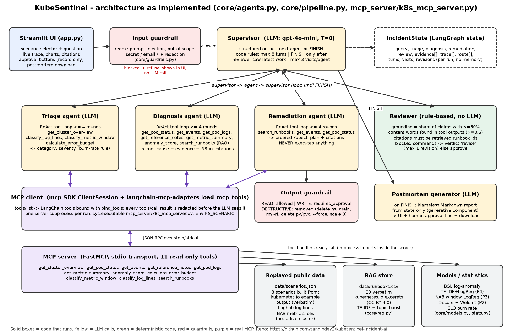

# 🛡️ KubeSentinel: multi-agent incident response for Kubernetes

**Repository:** https://github.com/sandipdey2/kubesentinel-incident-ai
**🚀 Live demo:** https://kubese-tbwobt7dmo4e4zbdef8t4e.streamlit.app/
**Author:** Sandip Dey · AI Mastery Capstone, Project 7: Integrative Industry Synthesis
**Industry:** Cloud / DevOps site reliability engineering (SRE)

KubeSentinel helps an on-call engineer through the first thirty minutes of a Kubernetes incident. It:
- triages severity and category,
- diagnoses a root-cause hypothesis with evidence and kubernetes.io citations,
- drafts a remediation plan in which every write step waits for human approval and destructive commands are blocked,
- writes a postmortem.

**It never executes a command.**

| What | How |
|---|---|
| Orchestration | LangGraph supervisor (gpt-4o-mini, temperature 0) that **loops** over Triage, Diagnosis, Remediation and Reviewer until FINISH, capped at 8 turns |
| Tools | **Real MCP**: a FastMCP server (`mcp` SDK) run as a stdio subprocess; 11 read-only tools converted with `langchain-mcp-adapters` and called by the LLM via `bind_tools` |
| RAG | TF-IDF over 29 verbatim kubernetes.io excerpts (CC BY 4.0), each with its source URL |
| ML / statistics | Loghub BGL log-anomaly classifier, NAB metric-window classifier, z-score + Welch's *t*-test, SLO burn rate |
| Guardrails | Input: injection / out-of-scope / secret + IP redaction. Output: READ / WRITE / DESTRUCTIVE command policy. Human-in-the-loop approval |
| Generative | LLM postmortem generated only from state facts |
| Data | **Public only**: Kubernetes docs, Loghub, NAB. The cluster is a **replay**, not live (see [DATA_SOURCES.md](DATA_SOURCES.md)) |

## Architecture


Every box maps to code:
- `app.py`: UI.
- `core/guardrails.py`: input and output guardrails.
- `core/agents.py`: supervisor, agents, reviewer and postmortem.
- `core/pipeline.py`: run entry point.
- `core/mcp_client.py`: stdio MCP client.
- `mcp_server/k8s_mcp_server.py`: the MCP server.
- `core/rag.py`, `core/models.py`, `core/stats.py`, `core/data_utils.py`: retrieval, models, statistics and data loading.

**Control flow (as implemented).**
1. `START → supervisor`. The LLM chooses `triage | diagnosis | remediation | reviewer | FINISH`. Each agent returns to the supervisor, and `FINISH` leads to `postmortem → END`.
2. Code-enforced rules, each logged as an `override` in the trace:
   - an 8-turn cap;
   - FINISH only after the reviewer has seen the latest work;
   - stop once the single revision is used (`approve_with_warnings`);
   - at most 3 visits per agent.
3. Each LLM specialist runs a ReAct-style tool loop of at most 4 rounds over its allowed MCP tools, then returns a pydantic-validated answer.
4. The **Reviewer is deterministic code, not an LLM**. It scores lexical grounding (≥ 0.6), checks that each cited runbook was actually retrieved, and returns `revise` if the output guardrail had to remove a command.
5. State lasts for one run only (`IncidentState`). There is no memory across incidents.

### About MCP (what is real and what is not)
- **Real:** the Model Context Protocol transport and messages. The app starts `python mcp_server/k8s_mcp_server.py` with `sys.executable` (so it also works on Streamlit Cloud), runs `initialize`, `tools/list` and `tools/call` through `mcp.ClientSession` over stdio, and wraps the tools for the LLM. Check it with `python scripts/verify_mcp.py`.
- **Not real:** the cluster. Tool handlers replay public data for the scenario named in `KS_SCENARIO`. Swapping the handlers for Kubernetes API calls would not change the client.
- All tools are read-only. The server process never receives the OpenAI key.

## Integration of prior capstone projects
| Project | Repo | Concept reused | Where |
|---|---|---|---|
| P1 AI Programming Foundations | [ai-programming-foundations-project](https://github.com/sandipdey2/ai-programming-foundations-project) | documented cleaning functions (`handle_missing_values` style) | `core/data_utils.py` |
| P2 Statistical Analysis | [statistical-analysis-project](https://github.com/sandipdey2/statistical-analysis-project) | Welch's *t*-test (`ttest_ind(equal_var=False)`), descriptive statistics | `core/stats.py` → `anomaly_score` tool |
| P3 Breast-cancer classification | [breast-cancer-classification](https://github.com/sandipdey2/breast-cancer-classification) | StandardScaler + LogisticRegression, held-out accuracy / precision / recall / F1, confusion matrix | NAB metric-window classifier (`core/models.py`) |
| P4 IMDB sentiment RNN | [imdb-sentiment-rnn](https://github.com/sandipdey2/imdb-sentiment-rnn) | text as supervised classification | Loghub BGL log-anomaly classifier (TF-IDF + LR instead of an LSTM: 2,000 lines, no PyTorch on Streamlit Cloud) |
| P5 Generative MNIST | [generative-mnist](https://github.com/sandipdey2/generative-mnist) | generated output needs qualitative scrutiny | LLM postmortem generator constrained to state facts |
| P6 Agentic RAG | [agentic-rag-system](https://github.com/sandipdey2/agentic-rag-system) | TF-IDF + topic-boost retrieval, rule-based reviewer, and its review feedback (no overclaiming, real loop, real MCP) | `core/rag.py`, reviewer, supervisor loop, MCP server |

## Evaluation results (from `evaluation.ipynb`, executed)
8 replayed incident scenarios and 5 adversarial prompts, run with the real LLM and the real MCP server:

| Metric | Value |
|---|---|
| Routing accuracy (all 4 agents visited, FINISH within the cap) | **1.0** |
| Triage category accuracy (labels = source kubernetes.io page) | **0.875** |
| Mean lexical grounding (min) | **0.941** (0.75) |
| Citation coverage (≥1 valid, 0 invalid) | **1.0** |
| Guardrail block rate (5 adversarial checks) | **1.0** |
| Output-guardrail unit suite | **14/14** |
| Destructive commands in any final plan | **0** (1 drain proposed by the LLM and blocked) |
| Mean / median latency | 62.5 s / 63.3 s |
| Mean MCP tool calls per run (total) | 11.9 (131) |
| Loghub BGL log-anomaly classifier (test n=500) | accuracy 0.998, F1 0.9859 |
| NAB metric-window classifier (5 held-out series) | accuracy 0.5038, F1 0.0979 (weak; shown to agents as a weak signal) |
| Rolling z-score vs NAB windows (20 series) | window recall 34/38 = 0.895, detection precision 0.155 |

**Failure cases observed:**
- `crashloop-app` was triaged as `other`.
- `node-notready` and `hpa-not-scaling` got SEV4 although NAB labels an anomaly in both slices.
- Several diagnoses with perfect lexical grounding still fused unrelated replayed signals into one causal story.
- The liveness plan proposed `kubectl exec … touch /tmp/healthy`, which hides the failure. It was held for approval as a WRITE step.

An earlier run (grounding 0.543) exposed a tokenizer bug in the grounding scorer, a weak RAG query prompt, a supervisor that would not finish, and the raw (unredacted) query being kept in the exported trace. All four were fixed. See the notebook's last cell.

## Run locally
```bash
git clone https://github.com/sandipdey2/kubesentinel-incident-ai.git
cd kubesentinel-incident-ai
python -m venv .venv && source .venv/bin/activate      # Python 3.13
pip install -r requirements.txt
export OPENAI_API_KEY=PASTE_YOUR_KEY_HERE
export OPENAI_API_BASE=https://openai.vocareum.com/v1
python scripts/verify_mcp.py          # MCP tools/list + tools/call over stdio (no LLM needed)
python scripts/smoke_test.py oomkilled
streamlit run app.py
```
Re-run the evaluation with `pip install -r requirements-dev.txt`, then
`jupyter nbconvert --to notebook --execute --inplace --ExecutePreprocessor.timeout=3600 --ExecutePreprocessor.kernel_name=python3 evaluation.ipynb`
(it takes about 15 minutes and makes real API calls).

Rebuild the data from upstream: `python scripts/fetch_data.py && python scripts/build_runbooks.py && python scripts/build_scenarios.py`.

## Deploy on Streamlit Community Cloud
**Live deployment:** https://kubese-tbwobt7dmo4e4zbdef8t4e.streamlit.app/

To deploy your own copy:
1. Push this repo to GitHub, then go to https://share.streamlit.io → **Create app**. Pick the repo, branch `main` and main file `app.py`.
2. **Advanced settings → Python version: 3.13.**
3. **Secrets:** paste the following (template in `.streamlit/secrets.toml.example`; the real `secrets.toml` is git-ignored):
   ```toml
   OPENAI_API_KEY = "PASTE_YOUR_KEY_HERE"
   OPENAI_API_BASE = "https://openai.vocareum.com/v1"
   ```
4. Deploy. The MCP server runs as a child process of the app (`sys.executable`), so no extra service is needed. The classifiers train at start-up in about 2 s.

## Reproducibility
- `requirements.txt` was pinned from the tested environment (Python 3.13.5, Linux) with `pip list --format=freeze`, filtered to direct and key packages. **Before submitting, regenerate it in your working env (Python 3.13.9):** `pip freeze > requirements.txt`. If you use Anaconda, `pip list --format=freeze > requirements.txt` avoids `file://` lines.
- All data subsets are committed in `data/raw/`, with download and build scripts. Seeds are fixed (`random_state=42`).

## Limitations
- The cluster is a replay. The logs and metrics were not recorded on the Kubernetes clusters shown in the docs, so cross-signal agreement is weak by construction.
- Evaluation is a single temperature-0 run of 13 cases, so the numbers are indicative, not a powered benchmark.
- Lexical grounding checks words, not causal reasoning. The guardrails are regex rules. Only the user's query is screened for injection, not the log text (indirect injection is still possible).
- Severity uses a burn-rate policy rule because no public dataset labels severity.
- There is no memory across incidents and no live Kubernetes API.

## Ethics and safeguards
- **Automation bias:** an LLM-proposed drain was blocked even though the prompt forbade it.
- **Human approval:** every WRITE step waits for approval. The UI only *records* the decision.
- **Privacy:** secrets, emails and IPs are redacted before the LLM sees them, and the MCP subprocess never gets the API key.
- **Accountability:** every route, tool call and override is in the downloadable trace.
- **Transparency:** replay status and citations are shown in the UI.

See `module_summary.pdf` for the full discussion.

## Repository layout
```
app.py                     Streamlit UI
core/                      agents, pipeline, guardrails, rag, models, stats, data_utils, mcp_client, config
mcp_server/                FastMCP stdio server (11 read-only tools)
data/raw/                  public dataset subsets (Loghub, NAB, kubernetes.io text)
data/runbooks.csv          29 verbatim kubernetes.io excerpts
data/k8s_doc_strings.csv   verbatim kubectl output strings used in scenarios
data/scenarios.json        8 replayed scenarios (built by scripts/build_scenarios.py)
scripts/                   fetch_data, build_runbooks, build_scenarios, verify_mcp, smoke_test, draw_architecture
evaluation.ipynb           executed evaluation; eval/ holds its saved outputs
module_summary.md / .pdf   reflective synthesis paper
architecture_diagram.png / .pdf
DATA_SOURCES.md            data licences, citations, subset method
```

## Data citations (APA 7)
- Zhu, J., He, S., He, P., Liu, J., & Lyu, M. R. (2023). Loghub: A large collection of system log datasets for AI-driven log analytics. *2023 IEEE 34th International Symposium on Software Reliability Engineering (ISSRE)*, 355–366. https://doi.org/10.1109/ISSRE59848.2023.00071
- Lavin, A., & Ahmad, S. (2015). Evaluating real-time anomaly detection algorithms: The Numenta Anomaly Benchmark. *2015 IEEE 14th International Conference on Machine Learning and Applications (ICMLA)*, 38–44. https://doi.org/10.1109/ICMLA.2015.141
- The Kubernetes Authors. (n.d.). *Kubernetes documentation*. https://kubernetes.io/docs/ (CC BY 4.0)
