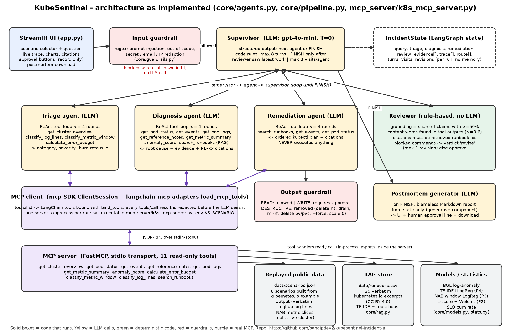

# KubeSentinel: A Multi-Agent Incident-Response Assistant for Kubernetes Operations

**Sandip Dey** · AI Mastery Capstone, Project 7: Integrative Industry Synthesis · Repository: https://github.com/sandipdey2/kubesentinel-incident-ai · Live demo: https://kubese-tbwobt7dmo4e4zbdef8t4e.streamlit.app/

## Overview and Industry Context

Cloud and DevOps teams running Kubernetes practise site reliability engineering (SRE). Reliability targets are set as service-level objectives (SLOs), and the downtime the business tolerates is managed as an error budget (Beyer et al., 2016). When a workload fails, the on-call engineer has to turn pod states, events, logs and metrics into a diagnosis and a safe fix, often at night and under time pressure. Kubernetes reports failures as many separate signals: CrashLoopBackOff, OOMKilled, FailedScheduling, a NotReady node, a failing probe. Its documentation spreads the matching debugging advice across dozens of pages (The Kubernetes Authors, n.d.).

KubeSentinel addresses the first thirty minutes of such an incident. It gathers evidence, classifies severity, proposes a root-cause hypothesis with documentation citations, drafts a remediation plan, and writes a postmortem. It never executes a command. The problem suits AI because it combines unstructured text (logs, events, documentation), numeric time series (metrics) and multi-step tool use. Those map onto NLP, statistics and agentic methods.

The industry constraints are severe. A wrong command during an outage can turn degradation into data loss. Logs routinely contain credentials and personal data such as IP addresses. Accountability for production changes must stay with a named human. A useful assistant therefore has to be traceable, conservative and explicitly subordinate to the engineer.

## Integration Rationale

KubeSentinel integrates all six prior capstone projects. Each one contributes a specific, inspectable component:

| Prior project | What it taught | Where it lives in KubeSentinel |
|---|---|---|
| P1 AI Programming Foundations (Titanic workflow) | small, documented cleaning functions before analysis | `core/data_utils.py`: loaders that validate, deduplicate and interpolate public data |
| P2 Statistical Analysis (Welch's *t*-test on MaxHR) | hypothesis testing between two groups | `anomaly_score`: Welch's *t*-test of a metric's 24-hour baseline against its last 2 hours, plus z-scores |
| P3 Breast-cancer classification (logistic regression, 0.965 accuracy) | scaled features, logistic regression, held-out metrics, confusion matrix | NAB metric-window classifier with the same pipeline |
| P4 IMDB sentiment LSTM (0.8535 validation accuracy) | text as a supervised classification problem | Loghub BGL log-anomaly classifier (TF-IDF + logistic regression) |
| P5 Generative MNIST GAN | generated output is plausible but needs qualitative scrutiny | LLM postmortem generator, constrained to state facts |
| P6 Agentic RAG system | TF-IDF retrieval, rule-based reviewer, and reviewer feedback about overclaiming | runbook RAG, a reviewer node, a real supervisor loop and a real MCP server |

The components build on one another rather than sitting side by side. The P1-style loaders feed the P2 statistics and the P3/P4 classifiers. Those models are exposed as Model Context Protocol (MCP) tools (Anthropic, 2024), and the P6-derived agents call them. The P5-style generator writes up whatever survives review.

Two decisions came straight from earlier results. P3's 0.965 accuracy came from clean, curated tabular data. Applying the same pipeline to NAB metric windows split by series gave F1 = 0.0979, and that gap made me treat the classifier as a weak signal instead of a decision-maker. In P4 the LSTM needed 40 epochs and 50,000 reviews to reach 0.8535. With only 2,000 labelled BGL lines and Streamlit Cloud's resource limits, I chose TF-IDF with logistic regression. It reached F1 = 0.9859 on the BGL test split.

## System Design and Technical Decisions

**Orchestration.** The system is a LangGraph state graph. After a regex input guardrail, a supervisor (gpt-4o-mini, temperature 0, structured output) chooses the next agent: Triage, Diagnosis, Remediation or Reviewer. Every agent returns to the supervisor, which loops until it outputs FINISH; a postmortem node then runs. This is a genuine loop, a direct response to the P6 reviewer, who noted that the earlier diagram promised a Plan-Act-Observe loop the code did not contain. Code enforces four limits and logs each override. Runs are capped at eight supervisor turns. FINISH is accepted only after the reviewer has seen the latest work. The run finishes once the single allowed revision is used. Each agent can be visited at most three times.

**Agents.** The three LLM specialists each run a bounded reason–act–observe loop of at most four tool rounds (Yao et al., 2023), then produce a schema-validated answer. The Reviewer is deterministic code, not an LLM. It computes a lexical grounding score, checks that each cited runbook ID was actually retrieved in the run, and applies the output policy. If the plan contained a blocked command or the grounding score is below 0.6, it returns "revise" and the supervisor sends the work back.

**Real MCP.** `mcp_server/k8s_mcp_server.py` is a FastMCP server built on the official `mcp` SDK. The app launches it as a subprocess over stdio, and LangChain tools are generated from `tools/list` with `langchain-mcp-adapters`. The server exposes eleven read-only tools and has no write tool by design. The transport and protocol are real. The cluster is not.

**Data: public only.** No live cluster is available on Streamlit Cloud, and I chose not to synthesise one. Each of the eight scenarios replays public data: verbatim `kubectl` output from kubernetes.io pages, verbatim Loghub log lines (Zhu et al., 2023), and a real Numenta Anomaly Benchmark (NAB) metric slice with its labels (Lavin & Ahmad, 2015). The build scripts fail if a string cannot be found on its source page. The only constructed element is the mapping that attaches a log set and a metric to a failure type.

**Retrieval.** The RAG store holds 29 runbooks of verbatim Kubernetes documentation excerpts (70 sentences, CC BY 4.0), retrieved with TF-IDF plus a topic boost (Lewis et al., 2020). KubeSentinel's own approval rules sit in a separate column, so the system's policy is never presented as documentation.

**Severity.** No public dataset labels incident severity, so severity comes from a stated policy rather than a learned label: the 2-hour error-budget burn rate, with the Site Reliability Workbook's 14.4×/6×/1× thresholds (Beyer et al., 2018).

**Tradeoffs and boundaries.** I accepted roughly 60 seconds of latency in exchange for a full trace. I chose lexical grounding over an LLM judge, which is cheaper and reproducible but blind to reasoning. I chose regex guardrails over learned ones, which are predictable but narrow. State lasts for a single run, with no memory across incidents. The system advises; humans decide and execute.

## Ethical Considerations and Responsible AI

**Automation bias and destructive remediation.** Under time pressure, operators tend to accept automated recommendations instead of checking them (Parasuraman & Manzey, 2010). In the evaluation, the Remediation agent proposed `kubectl drain kube-worker-1 --ignore-daemonsets --delete-emptydir-data` even though its prompt forbade drains. Prompting alone is therefore not a safeguard. The output guardrail removed the command, and the reviewer forced a revision that only cordoned the node. Subtler cases got through as legitimate WRITE steps. For a failing liveness probe, the plan proposed `kubectl exec … touch /tmp/healthy`, which would hide the failure rather than fix it. For the HPA, it proposed applying a remote `latest` manifest. Both were held for human approval, and that is the safeguard that caught them. This is why every write step needs explicit sign-off and the UI records the decision instead of executing it.

**Transparency and overclaiming.** Several diagnoses scored perfect grounding while fusing unrelated replayed signals into one causal story, for example blaming an OOM kill partly on YARN scheduling headroom. A grounding check confirms that the words came from tool outputs; it cannot confirm that the reasoning is valid. The UI therefore shows evidence, caveats, confidence and every tool call, and both the documentation and the app say that the cluster is a replay.

**Privacy.** Real logs leak data. The OpenSSH lines in the DNS scenario contain public IP addresses, and adversarial prompts contained passwords. Every MCP result and every user query is redacted before the LLM sees it, and the MCP subprocess never receives the API key. The evaluation also caught my own defect: the raw query was being kept in the exported trace. I fixed it so that only the redacted query is stored. Kubernetes' own guidance that Secrets are stored unencrypted in etcd by default reinforces the point (The Kubernetes Authors, n.d.).

**Accountability and governance.** Following the NIST AI Risk Management Framework's *govern* and *manage* functions (National Institute of Standards and Technology [NIST], 2023), KubeSentinel keeps a human incident commander accountable, keeps tools read-only, and logs every route and override. Indirect prompt injection through logs remains an open risk (Greshake et al., 2023), because the input guardrail screens only the user's query.

## Evaluation and Reflection

The evaluation notebook ran 8 incident scenarios and 5 adversarial prompts end-to-end with the real model and the real MCP server:

- **Routing accuracy: 1.0.** Every incident run visited all four agents and finished within the turn cap.
- **Triage category accuracy: 0.875**, against labels taken from the documentation pages.
- **Mean lexical grounding: 0.941.**
- **Citation coverage: 1.0.**
- **Guardrail block rate: 1.0.** All five adversarial checks passed, and 14/14 commands were classified correctly in the guardrail unit suite.
- **Cost:** a mean latency of 62.5 s and 11.9 MCP calls per run.

The ML components were mixed. The BGL log classifier scored F1 = 0.9859. The NAB window classifier scored F1 = 0.0979 on held-out series. The rolling z-score detector found 34 of 38 NAB anomaly windows but had a precision of only 0.155.

**Failure cases.** Triage labelled the crash-loop scenario "other" because the replayed Java network exception outweighed the pod status line. Severity was SEV4 for node-notready and hpa-not-scaling, although NAB labels anomalies in both slices: a slow drift and a noisy baseline never crossed 3σ.

**What did not work at first.** My first evaluation run gave grounding of 0.543 and citation coverage of 0.8. The cause was mostly a tokenizer bug in my scorer and a Diagnosis prompt that searched the runbooks only with application log text. Fixing my own instrument before trusting my system was the clearest lesson of the project. The current results come from a single run at temperature 0 and are indicative, not statistically powered.

**What I learned.** Integration exposes what single projects hide. Each component looked strong in isolation: 0.965 accuracy in P3 and a grounded RAG answer in P6. Combining them revealed that transfer, causal reasoning and safety had to be designed for explicitly. I also learned to describe only what the code does. Every box in the architecture diagram maps to a file.

## Professional Relevance

This project reflects the work of an AI or platform engineer in an SRE organisation. It frames an operational problem in SLO terms, chooses models according to data size and deployment limits, and integrates LLM agents through a standard protocol (MCP) instead of ad-hoc glue. It also treats safety as layered engineering: prompts, deterministic guardrails, review and human approval. The artifact is reproducible: pinned requirements, fetch and build scripts for every dataset, an executed evaluation notebook, and a Streamlit Cloud deployment that uses secrets instead of hard-coded keys. Just as important for employers, it shows professional honesty. It reports weak results such as F1 = 0.0979, discloses an evaluation that had to be fixed, and separates implemented behaviour from future work, such as a live Kubernetes API backend, log-side injection screening and an LLM-based faithfulness judge (Es et al., 2024). The system is deployed publicly on Streamlit Community Cloud (https://kubese-tbwobt7dmo4e4zbdef8t4e.streamlit.app/), where reviewers can replay each scenario and inspect the full agent trace.

## References

Anthropic. (2024, November 25). *Introducing the Model Context Protocol*. https://www.anthropic.com/news/model-context-protocol

Beyer, B., Jones, C., Petoff, J., & Murphy, N. R. (Eds.). (2016). *Site reliability engineering: How Google runs production systems*. O'Reilly Media. https://sre.google/sre-book/table-of-contents/

Beyer, B., Murphy, N. R., Rensin, D. K., Kawahara, K., & Thorne, S. (Eds.). (2018). *The site reliability workbook: Practical ways to implement SRE*. O'Reilly Media. https://sre.google/workbook/alerting-on-slos/

Es, S., James, J., Espinosa Anke, L., & Schockaert, S. (2024). RAGAs: Automated evaluation of retrieval augmented generation. In *Proceedings of the 18th Conference of the European Chapter of the Association for Computational Linguistics: System Demonstrations* (pp. 150–158). Association for Computational Linguistics. https://doi.org/10.18653/v1/2024.eacl-demo.16

Greshake, K., Abdelnabi, S., Mishra, S., Endres, C., Holz, T., & Fritz, M. (2023). Not what you've signed up for: Compromising real-world LLM-integrated applications with indirect prompt injection. In *Proceedings of the 16th ACM Workshop on Artificial Intelligence and Security* (pp. 79–90). ACM. https://doi.org/10.1145/3605764.3623985

Lavin, A., & Ahmad, S. (2015). Evaluating real-time anomaly detection algorithms: The Numenta Anomaly Benchmark. In *2015 IEEE 14th International Conference on Machine Learning and Applications (ICMLA)* (pp. 38–44). IEEE. https://doi.org/10.1109/ICMLA.2015.141

Lewis, P., Perez, E., Piktus, A., Petroni, F., Karpukhin, V., Goyal, N., Küttler, H., Lewis, M., Yih, W., Rocktäschel, T., Riedel, S., & Kiela, D. (2020). Retrieval-augmented generation for knowledge-intensive NLP tasks. *Advances in Neural Information Processing Systems, 33*, 9459–9474.

National Institute of Standards and Technology. (2023). *Artificial intelligence risk management framework (AI RMF 1.0)* (NIST AI 100-1). U.S. Department of Commerce. https://doi.org/10.6028/NIST.AI.100-1

Parasuraman, R., & Manzey, D. H. (2010). Complacency and bias in human use of automation: An attentional integration. *Human Factors, 52*(3), 381–410. https://doi.org/10.1177/0018720810376055

The Kubernetes Authors. (n.d.). *Kubernetes documentation*. Retrieved November 12, 2026, from https://kubernetes.io/docs/ (CC BY 4.0)

Yao, S., Zhao, J., Yu, D., Du, N., Shafran, I., Narasimhan, K., & Cao, Y. (2023). ReAct: Synergizing reasoning and acting in language models. In *Proceedings of the Eleventh International Conference on Learning Representations (ICLR 2023)*. https://arxiv.org/abs/2210.03629

Zhu, J., He, S., He, P., Liu, J., & Lyu, M. R. (2023). Loghub: A large collection of system log datasets for AI-driven log analytics. In *2023 IEEE 34th International Symposium on Software Reliability Engineering (ISSRE)* (pp. 355–366). IEEE. https://doi.org/10.1109/ISSRE59848.2023.00071
